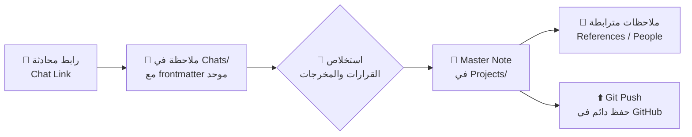

# 🏠 Home — مركز القيادة

خزنة **Obsidian** لمشاريع مترابطة، مبنية بطريقة Steph Ango (kepano) — مبتكر Obsidian: *File over app*، ملاحظة رئيسية (Master note) لكل مشروع، وربط مكثف بالروابط الداخلية (Wikilinks).

> [!tip] ابدأ من هنا
> 1. اقرأ [[README|تقرير الجاهزية]] لفهم النظام كاملاً.
> 2. أنشئ مشروعك الأول: مجلد `Projects` ← ملاحظة جديدة (سيُطبّق قالب Master تلقائياً).
> 3. أرسل لي روابط محادثاتك وسأحوّلها إلى ملاحظات مترابطة.

## المشاريع النشطة (Active Projects)

```dataview
TABLE status AS "Status", date AS "Created"
FROM "Projects"
WHERE status = "active" OR status = "example"
SORT date DESC
```

## أحدث المحادثات (Latest Chats)

```dataview
TABLE chat_date AS "Date", project AS "Project", status AS "Status"
FROM "Chats"
SORT chat_date DESC
LIMIT 10
```

## خرائط الفئات (Category Maps)

| الخريطة | الوظيفة |
| --- | --- |
| [[Categories/Projects.base\|🗂️ Projects]] | كل المشاريع وحالتها |
| [[Categories/Chats.base\|💬 Chats]] | كل محادثاتك مع روابطها |
| [[Categories/People.base\|🧑 People]] | الأشخاص المرتبطون بالمشاريع |
| [[Categories/References.base\|📚 References]] | المراجع بتقييم نجوم kepano |
| [[Canvas/Project Map.canvas\|🗺️ Project Map]] | الخريطة البصرية للخزنة |

## كيف تعمل الخزنة؟ (Workflow)



%% القواعد الكاملة للعمل داخل الخزنة موثقة في [[AGENTS]] — أي وكيل AI يعمل هنا يجب أن يقرأه أولاً %%
