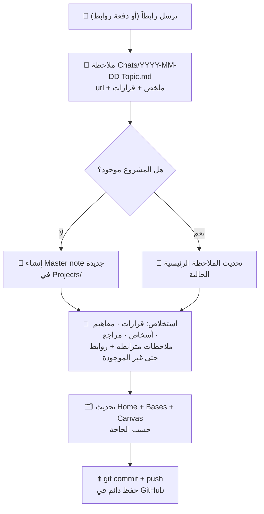

# 🏔️ Obsidian Vault — تقرير الجاهزية (Readiness Report)

> **الإصدار:** 1.0.0 · **التاريخ:** 2026-11-10 · **الحالة:** ✅ **جاهز للاستلام**
> **المالك:** hafid-logic · **المستودع:** [hafid-logic/Obsidian](https://github.com/hafid-logic/Obsidian) · **المُعدّ:** وكيل Z.ai
>
> ⚠️ *الروابط بين القوسين المزدوجين مثل* [[Home]] *تفتح الملاحظات مباشرة داخل Obsidian — وعلى GitHub تظهر كنص فقط.*

---

## 1. الملخص التنفيذي (Executive Summary)

جاهز. درست المستودعين المطلوبين بعمق، بنيتُ خزنة كاملة قابلة للفتح في Obsidian من أول لحظة، وتهيأتُها لتعمل كنظام **مشاريع مترابطة** يُغذّى من روابط محادثاتك. كل شيء هنا ملفات Markdown تملكها أنت — لا قفل على أي تطبيق.

| المكوّن | الحالة |
| --- | --- |
| هيكل الخزنة بطريقة kepano (Master notes + Bases) | ✅ مبني |
| قوالب Templater لكل نوع ملاحظة | ✅ 6 قوالب |
| الإضافات الثلاث مثبتة مسبقاً (بلا إنترنت) | ✅ Dataview · Templater · Excalidraw |
| قالب Minimal لـ kepano | ✅ مثبت ومفعّل (إصدار 9.1.4) |
| مهارات الوكلاء من `kepano/obsidian-skills` | ✅ منسوخة في `.claude/skills/` |
| نظام استقبال روابط المحادثات (SOP) | ✅ موثّق في [[AGENTS]] |
| Git + مفتاح SSH للرفع التلقائي | ✅ **مفعّل — والخزنة مرفوعة فعلياً إلى GitHub** |
| مثال تشغيلي كامل (مشروع + محادثة + خريطة) | ✅ [[Example Project]] |

**الخطوة التالية الوحيدة:** ترسل لي روابط محادثاتك — وسأحوّلها إلى مشاريع مترابطة وفق الإجراء الموثق أدناه، وكل جولة تنتهي برفع مباشر إلى GitHub.

---

## 2. ماذا تعلمت من المستودعين؟ (What I Learned)

### 2.1 مستودع `obsidianmd/obsidian-releases` — النظام حول التطبيق

هذا المستودع **لا يحتوي كود Obsidian نفسه** (التطبيق مغلق المصدر)، لكنه يكشف كيف يعمل Obsidian فعلياً من حوله، وهو ما طبقتُه حرفياً عند بناء خزنتك:

1. **آلية تثبيت الإضافات الرسمية**: يقرأ Obsidian فهرس `community-plugins.json` (أكثر من 2,400 إضافة)، ثم يسحب `manifest.json` + `main.js` + `styles.css` من GitHub Releases لكل إضافة ويحفظها في `.obsidian/plugins/<id>/`. **استخرجتُ من الفهرس مستودعات الإضافات الثلاث التي اخترتها ونزّلتُ ملفاتها بنفس الآلية الرسمية بالضبط** — خزنتك تعمل دون حاجة لفتح المتصفح الداخلي للإضافات.
2. **دورة الإصدارات**: ملف `desktop-releases.json` يوثّق أحدث إصدار للتطبيق عند إنشاء هذا التقرير: **Obsidian 1.15.0** — وأي إضافة في الخزنة متوافقة معه (أعلى متطلب: Templater بحاجة 1.13.0).
3. **سياسات المراجعة** (`plugin-review.md` → [Plugin guidelines](https://docs.obsidian.md/Plugins/Releasing/Plugin+guidelines)): فهمتُ معايير الجودة الرسمية (عدم التطفل على الملفات، التسجيل الصحيح، إدارة الذاكرة) — أي إضافة نقترحها مستقبلاً ستُفحص أولاً ضد هذه المعايير.

### 2.2 مستودع `kepano/obsidian-skills` — كيف يعمل وكيل AI داخل خزنة باحتراف

هذا المستودع (لمبتكر Obsidian والرئيس التنفيذي Steph Ango “kepano”) يحتوي 6 مهارات وفق [مواصفة Agent Skills](https://agentskills.io/) تُعلّم أي وكيل AI العمل الصحيح داخل الخزنة. **نسختها كاملة إلى `.claude/skills/` في خزنتك** واعتمدتها قانوناً ملزماً في [[AGENTS]]:

| المهارة | ماذا تعلّمنا منها وكيف نطبقها في خزنتك |
| --- | --- |
| `obsidian-markdown` | صيغة Obsidian Flavored Markdown: wikilinks للداخل، Markdown links للخارج، callouts، `%%تعليقات%%`، خصائص frontmatter موحدة |
| `obsidian-bases` | بناء ملفات `.base` (فلاتر، formulas، views) — بنينا بها خرائط `Categories/` الخمس، وملاحظة النوع الجديد التي تعرض محادثات كل مشروع تلقائياً |
| `json-canvas` | مواصفة JSON Canvas 1.0: عقد وحواف ومعرفات سداسية عشرية — بُنيت بها [[Canvas/Project Map.canvas\|الخريطة البصرية]] |
| `obsidian-cli` | التحكم في Obsidian مفتوحاً من سطر الأوامر (قراءة، بحث، خصائص، لقطات) — سيرتفع معدل أتمتتنا عند تشغيلك للتطبيق |
| `defuddle` | استخلاص نص صفحة الويب نظيفاً بلا فوضى — سنستخدمه لالتقاط محتوى روابطك بدقة وتوفير التوكنات |
| `knap` | توليد ملاحظات بالجملة من JSON/CSV — عند إرسالك دفعة روابط دفعة واحدة |

> **الخلاصة**: المستودع الأول علّمنا *كيف يُبنى نظام Obsidian*، والثاني علّمنا *كيف يُدار باحتراف بواسطة وكيل AI*. الجمع بينهما هو ما بُنيت خزنتك عليه.

---

## 3. فلسفة kepano المطبقة (File over App)

من مدونته الرسمية ([stephango.com/vault](https://stephango.com/vault)) وثيقة قواعده الشخصية، اعتمدنا:

| قاعدة kepano | تطبيقنا في خزنتك |
| --- | --- |
| **File over app**: ملفات تتحكم بها بصيغ مفتوحة | كل شيء Markdown / YAML / JSON — الخزنة تعمل بلا Obsidian أصلاً |
| **روابط داخلية بكثافة**، وحتى الروابط غير الموجودة بعد (unresolved) قيمة | كل ملاحظة تربط ما حولها — Graph View سيتضخم تلقائياً مع مشاريعك |
| **وسوم بصيغة الجمع دائماً** | `projects`, `chats`, `people`, `references`, `daily`, `clippings` |
| **تواريخ `YYYY-MM-DD` في كل مكان** | أسماء محادثاتك `2026-11-10 Topic.md` والملاحظات اليومية بنفس الصيغة |
| **تجنب المجلدات كأداة تنظيم** — التنظيم بالخصائص والروابط | التزمنا به في جوهره: ملاحظة واحدة مسطحة لكل مشروع، لا مجلدات فرعية أبداً |
| **بضعة مجلدات إدارية فقط** (Attachments, Daily, Templates, References, Clippings) | اعتمدناها كما هي + مجلدات `Projects/` و `Chats/` و `People/` و `Categories/` و `Canvas/` — **تعديل مقصود موثّق** لأن الوكيل يحتاج حدوداً واضحة للقوالب التلقائية والأتمتة |
| **قواعد مكتوبة تبدد قرارات مستقبلية مئات المرات** | [[AGENTS]] هو دفتر قواعدنا — أي وكيل يقرأه قبل أول تعديل |

---

## 4. بنية الخزنة (Vault Structure)

```
Obsidian/
├── README.md          ← هذا التقرير
├── AGENTS.md          ← دليل التشغيل الإلزامي للوكلاء AI
├── Home.md            ← 🏠 مركز القيادة: مشاريع نشطة + أحدث المحادثات + خريطة عمل
├── Projects/          ← 📌 Master note واحدة لكل مشروع (مثال جاهز: Example Project)
├── Chats/             ← 💬 ملاحظة لكل رابط محادثة (نموذج أول جاهز)
├── References/        ← 📚 مراجع خارجية بتقييم سلّم kepano من 7
├── People/            ← 🧑 الأشخاص المرتبطون بالمشاريع
├── Clippings/         ← ✂️ وجهة Obsidian Web Clipper
├── Daily/             ← 📅 ملاحظات يومية YYYY-MM-DD.md
├── Templates/         ← 🧩 6 قوالب Templater (تُطبَّق تلقائياً حسب المجلد)
├── Categories/        ← 🗂️ 5 خرائط Bases: Projects · Chats · People · References · Project Chats
├── Canvas/            ← 🗺️ الخريطة البصرية Project Map.canvas
├── Attachments/       ← 🖼️ كل الوسائط (وجهة المرفقات الافتراضية)
├── .claude/skills/    ← 🤖 حزمة مهارات kepano الست كاملة
└── .obsidian/         ← ⚙️ تهيئة كاملة: إضافات مثبتة + Minimal + إعدادات Graph و Daily و Templater
```

### الإضافات المثبتة مسبقاً (Pre-installed)

| الإضافة | الإصدار | الدور في نظامك |
| --- | --- | --- |
| [Dataview](https://github.com/blacksmithgu/obsidian-dataview) | 0.5.68 | جداول ديناميكية في Home و Daily والمشاريع |
| [Templater](https://github.com/silentvoid13/Templater) | 2.27.0 | تطبيق القالب الصحيح تلقائياً حسب مجلد الملاحظة |
| [Excalidraw](https://github.com/zsviczian/obsidian-excalidraw-plugin) | 2.29.2 | رسومات ومخططات يدوية داخل الخزنة |
| [Minimal — قالب kepano](https://github.com/kepano/obsidian-minimal) | 9.1.4 | الشكل الرسمي + لون مميز من عائلة Flexoki (`#BC4B00`) |

> **ملاحظة تقنية**: Mermaid (المخططات داخل الملاحظات) و Canvas و Graph View مفعّلة من إضافات Obsidian **الأساسية** — لا تحتاج شيئاً. أما **Obsidian Web Clipper** فهو إضافة متصفح رسمية ([صفحتها](https://obsidian.md/clipper))، وخزنتك جاهزة لاستقبال ما يلتقطه في `Clippings/` بقالب تلقائي.

---

## 5. آلية استقبال روابط المحادثات (The Chat-Link SOP)

هذا هو القلب التشغيلي: **ترسل لي روابط محادثاتك، فتتحول إلى مشروع مترابط موثّق.**



**الخصائص الموحدة التي تجعل الترابط ممكناً** (تُعرض تلقائياً في خرائط Bases):

| الخاصية | النوع | الوظيفة |
| --- | --- | --- |
| `type` | نص | `chat` / `project` / `reference` / `person` / `daily` |
| `status` | نص | دورة حياة واضحة: `new → processed` للمحادثات، `active → paused → done` للمشاريع |
| `project` | قائمة روابط | يربط المحادثة بكل مشاريعها — **أساس الترابُط** |
| `chat_date` | تاريخ | ترتيب زمني وسحب ملاحظات اليوم تلقائياً |
| `url` | نص | الرابط الأصلي المحفوظ — لا يُحذف أبداً |
| `rating` | رقم 1-7 | تقييم المراجع بسلّم kepano |

**وكل ذلك محكوم بالقواعد الصارمة في [[AGENTS]]**: لا اختلاق محتوى لمحادثة لم تصل، لا حذف سجلات، لا أسرار في الملاحظات، ورفع فوري بعد كل جولة.

---

## 6. كيف تشغّل الخزنة؟ (Setup in 60 seconds)

1. حمّل ملف `Obsidian-Vault.zip` المرفق بهذا التسليم (أو `git clone` المستودع بعد تفعيل المفتاح).
2. فك الضغط — سيظهر مجلد `Obsidian/`.
3. افتح تطبيق Obsidian ← **Open folder as vault** ← اختر مجلد `Obsidian`.
4. عند سؤال الثقة بالمجتمع: فعّل **Community plugins** (الملفات الثلاثة موجودة أصلاً محلياً — التفعيل مجرد موافقة أمان).
5. افتح [[Home]] — وسترى المشاريع والمحادثات والخرائط تعمل فوراً.

> اختياري لكن مُوصى به: ثبّت إضافة المتصفح الرسمية **Obsidian Web Clipper** لتلتقط أي صفحة إلى `Clippings/` مباشرة.

---

## 7. Git + SSH — الحماية من ضياع العمل

وفق طلبك: **كل تحسين أو تغيير مستقبلي سيُرفع فوراً** إلى [hafid-logic/Obsidian](https://github.com/hafid-logic/Obsidian) حتى لا يتأثر شيء بتدوير بيئة الوكيل. ما أُنجز الآن:

- ✅ `git init` على الفرع `main` + أول commit — المفتاح الخاص **خارج المستودع إطلاقاً** و `.gitignore` يمنع أي مفتاح من الدخول.
- ✅ Remote مضبوط: `git@github.com:hafid-logic/Obsidian.git` (بروتوكول SSH كما طلبت).
- ✅ مفتاح **ed25519** مولّد ومحفوظ في بيئة العمل الدائمة (يُعاد توليده تلقائياً إذا تُرك بلا استعمال طويلاً).
- ✅ **المفتاح مُفعّل كـ Deploy key بكتابة، والمصادقة نجحت، والخزنة مرفوعة فعلياً**: الفرع `main` الآن مباشر على GitHub (تحقق `git ls-remote` = مطابقة تامة للهاش `1b306f8`).

### المفتاح العام (Public Key) — مُفعّل على GitHub:

```
ssh-ed25519 AAAAC3NzaC1lZDI1NTE5AAAAIMNDnYzKKf78OBtyJthfAfEPPhHHgcljcEJV61T+iF+B zai-agent-hafid-logic-obsidian
```

- **البصمة (SHA256):** `xWENGHQ8mMqq4Q8kFdLVUoEpbSIf/F4avRdgTPBYAVg`

### خطوات التفعيل — ✅ **منفذة ومُتحقق منها** (أُوصى بـ Deploy Key):

1. افتح المستودع ← **Settings** ← **Deploy keys** ← **Add deploy key**. ✅
2. الصق المفتاح أعلاه في الحقل `Key`، وسمّه مثل `zai-agent-vault`. ✅
3. **فعّل خيار ✅ Allow write access** (بدونه لا أستطيع الرفع). ✅
4. المصادقة نجحت والرفع الأول تم — منذ هذه اللحظة كل جولة عمل تنتهي بـ `commit + push` تلقائي. ✅

> 🔍 **ملاحظة أمنية إضافية**: أثناء الاتصال تحققنا من بصمة مفتاح خادم GitHub الحي `SHA256:+DiY3wvvV6TuJJhbpZisF/zLDA0zPMSvHdkr4UvCOqU` ومطابقتها للبصمة الرسمية المنشورة في docs.github.com — لا وساطة وسيطة (MITM).

> 🔒 **لماذا Deploy key وليس مفتاح حسابك؟** لأن صلاحيته محصورة بهذا المستودع وحده، ويمكنك إلغاؤها بأي لحظة دون المساس بحسابك. القاعدة في [[AGENTS]] رقم 4 تمنع أي سر من دخول الملاحظات — المفتاح الخاص لا يعيش إلا في بيئة العمل.

---

## 8. ما أحتاجه منك الآن (What I Need From You)

1. **روابط محادثاتك** — أرسلها بالصيغة التي تريحك: رابطاً رابطاً، دفعة واحدة، أو قائمة مع وصف موجز لكل رابط. لا بأس بربط عدة روابط بمشروع واحد، أو رابط واحد بعدة مشاريع.
2. **أسماء المشاريع** إن كانت لديك مسبقاً — وإلا فسأستنبطها من محتوى الروابط نفسها وأعرضها عليك للاعتماد.
3. ~~تفعيل مفتاح SSH~~ ✅ **تم** — الرفع يعمل بكامل صلاحياته.
4. *(اختياري)* أي قواعد خاصة تريدها فوق قواعد [[AGENTS]] — النظام قابل للتوسعة بقرار موثق.

---

## 9. المصادر (Sources)

- [obsidianmd/obsidian-releases](https://github.com/obsidianmd/obsidian-releases) — الإصدارات وفهرس الإضافات وآلية التثبيت الرسمية (نُفذت حرفياً).
- [kepano/obsidian-skills](https://github.com/kepano/obsidian-skills) — مهارات الوكلاء الست (منسوخة في `.claude/skills/`).
- [stephango.com/vault](https://stephango.com/vault) — قواعد kepano الشخصية وبنيته.
- [stephango.com/file-over-app](https://stephango.com/file-over-app) — فلسفة الملف فوق التطبيق.
- [Obsidian Flavored Markdown](https://help.obsidian.md/obsidian-flavored-markdown) · [Bases syntax](https://help.obsidian.md/bases/syntax) · [JSON Canvas Spec](https://jsoncanvas.org/spec/1.0/)

---

*أُعدّ هذا التقرير وبُنيت الخزنة بواسطة وكيل Z.ai بتاريخ 2026-11-10 — أول commit في المستودع هو لحظة ميلاد النظام.*
